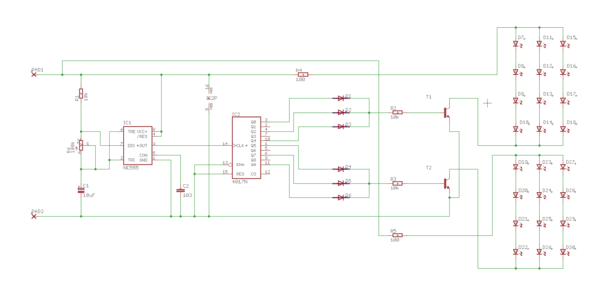
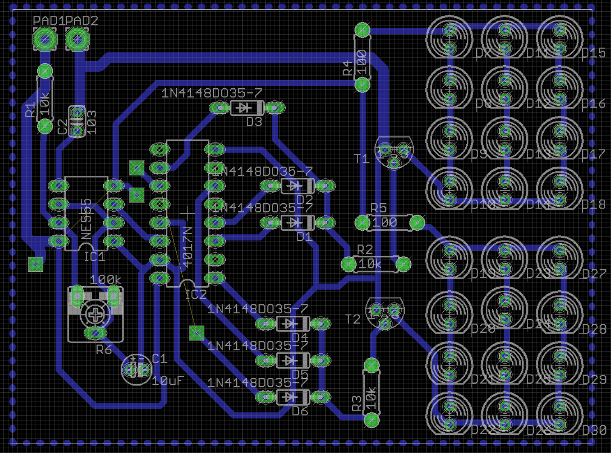
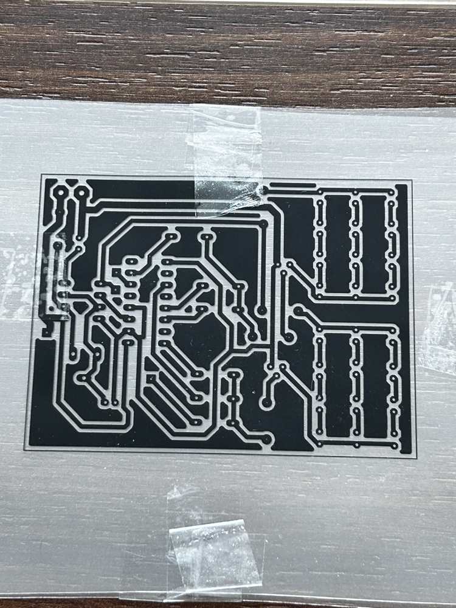
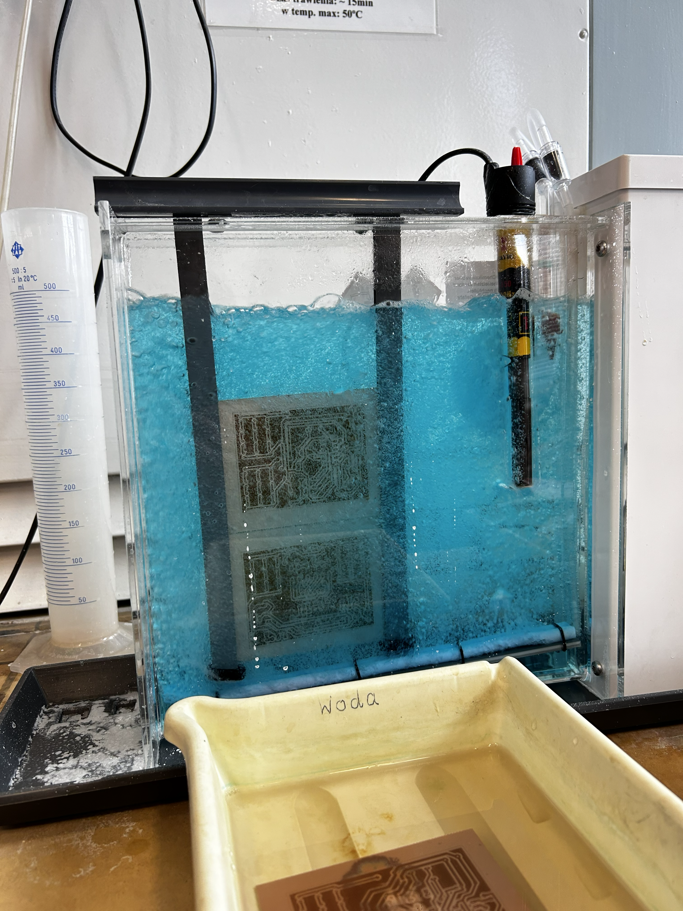
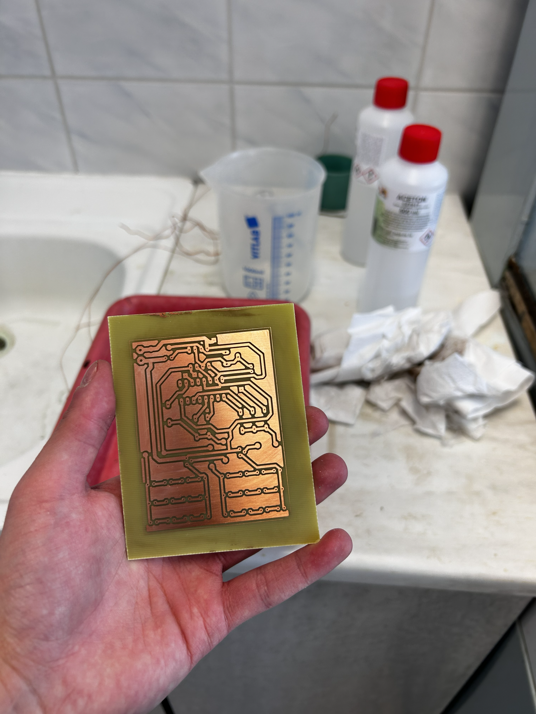
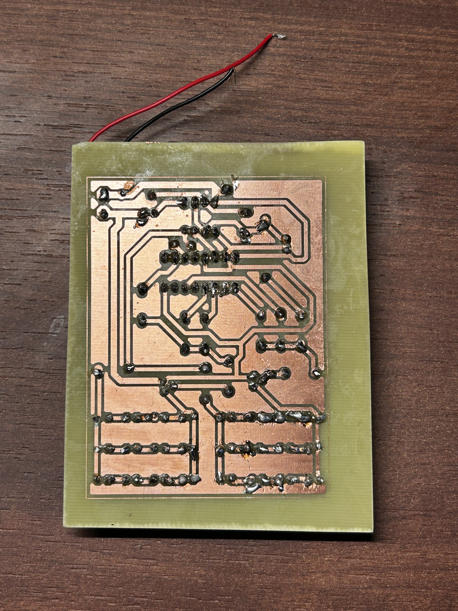
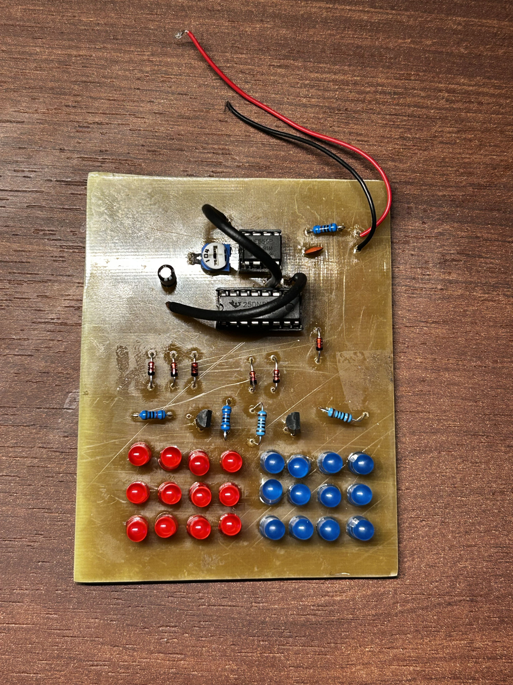
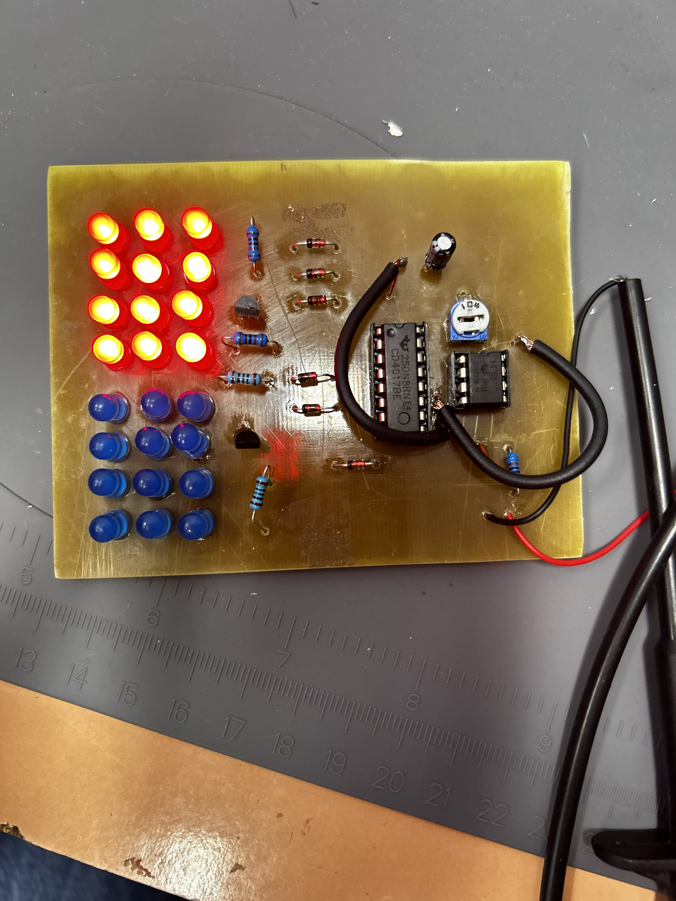
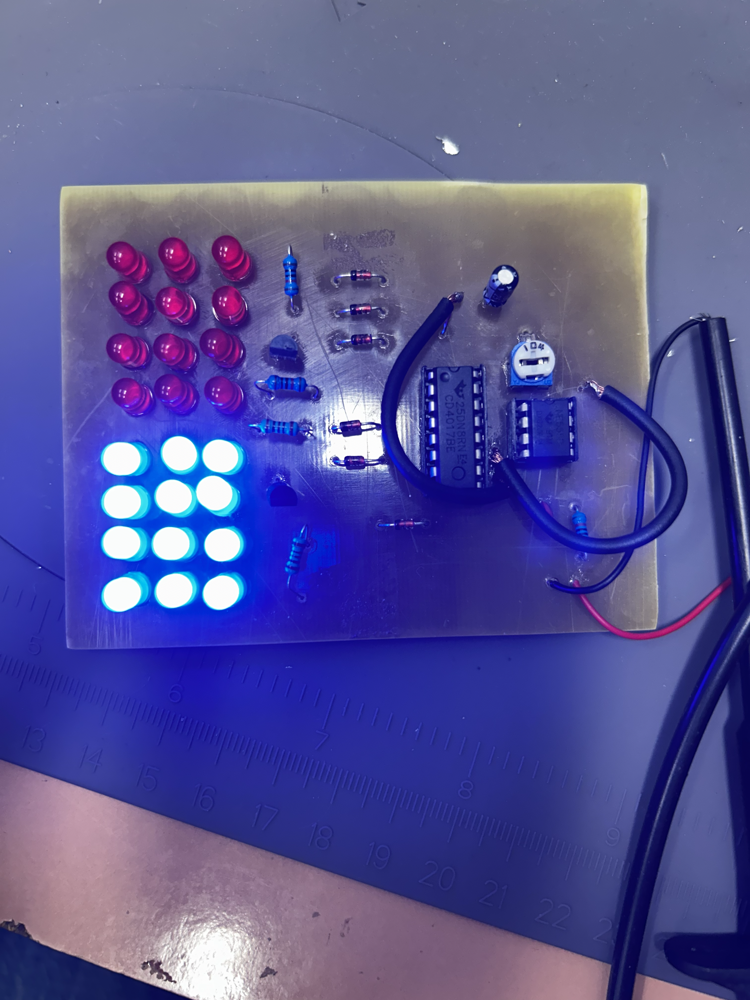

# Dwukolorowa lampa ostrzegawcza

Projekt zrealizowany w ramach przedmiotu **Projektowanie i konstrukcja urządzeń** na Uniwersytecie Morskim w Gdyni.

## Opis projektu

Prezentowany układ to elektroniczny moduł sygnalizacyjny, który symuluje działanie świateł ostrzegawczych (tzw. "koguta policyjnego"). Konstrukcja opiera się na układach scalonych NE555 oraz CD4017. Efektem działania urządzenia jest naprzemienne błyskanie dwóch grup diod LED w kolorze niebieskim oraz czerwonym. Zastosowanie potencjometru pozwala na płynną regulację częstotliwości błysków.

---

## Wykaz elementów

*Tabela 1. Tabela elemento w zastosowanych w układzie*

| Nazwa elementu | Ilość | Oznaczenia |
| :--- | :---: | :--- |
| Rezystor 10kΩ | 3 | R1, R2, R3 |
| Rezystor 100Ω | 2 | R4, R5 |
| Potencjometr | 1 | RW |
| Kondensator elektrolityczny 10µF | 1 | C1 |
| Kondensator ceramiczny 10nF | 1 | C2 |
| Dioda 1N4148 | 6 | D1-D6 |
| Czerwona dioda LED | 12 | D7-D18 |
| Niebieska dioda LED | 12 | D19-D30 |
| Tranzystor 8050 | 2 | Q1, Q2 |
| Układ scalony NE555 | 1 | U1 |
| Układ scalony CD4017 | 1 | U2 |
| Podstawka pod układ NE555 | 1 | U1 |
| Podstawka pod układ CD4017 | 1 | U2 |
| Przewód montażowy czerwony 10cm | 1 | - | 
| Przewód montażowy czarny 10cm | 1 | - |

---

## Schemat elektryczny, mozaika ścieżek i maska na folii

<figure>
  
  <figcaption align="center"><em>Rysunek 1. Schemat elektryczny w programie Eagle</em></figcaption>
</figure>

<figure>
  
  <figcaption align="center"><em>Rysunek 2. Mozaika ścieżek w programie Eagle</em></figcaption>
</figure>

<figure>
  
  <figcaption align="center"><em>Rysunek 3. Maska na folii</em></figcaption>
</figure>

---

## Płytka przed i po konstrukcji

<table width="100%">
  <tr>
    <td align="center" width="50%">
      
       
      <em>Rysunek 4. Płytka po wywołaniu</em>
    </td>
    <td align="center" width="50%">
      
       
      <em>Rysunek 5. Płytka po wytrawieniu</em>
    </td>
  </tr>
</table>

<table width="100%">
  <tr>
    <td align="center" width="50%">
      
       
      <em>Rysunek 6. Widok płytki PCB po montażu warstwa górna</em>
    </td>
    <td align="center" width="50%">
      
       
      <em>Rysunek 7. Widok płytki PCB po montażu strona ścieżki</em>
    </td>
  </tr>
</table>

---

## Wnioski

<table width="100%">
  <tr>
    <td align="center" width="50%">
      
       
      <em>Rysunek 8. Prezentacja działania zmontowanego układu faza aktywności diod LED czerwonych</em>
    </td>
    <td align="center" width="50%">
      
       
      <em>Rysunek 9. Prezentacja działania zmontowanego układu faza aktywności diod LED niebieskich</em>
    </td>
  </tr>
</table>

Na podstawie przeprowadzonych testów laboratoryjnych stwierdzono, że zmontowany układ elektroniczny działa w pełni poprawnie i zgodnie z założeniami projektowymi. Urządzenie bezproblemowo przełącza się pomiędzy fazą aktywności diod LED czerwonych (Rys. 8) a fazą aktywności diod LED niebieskich (Rys. 9).